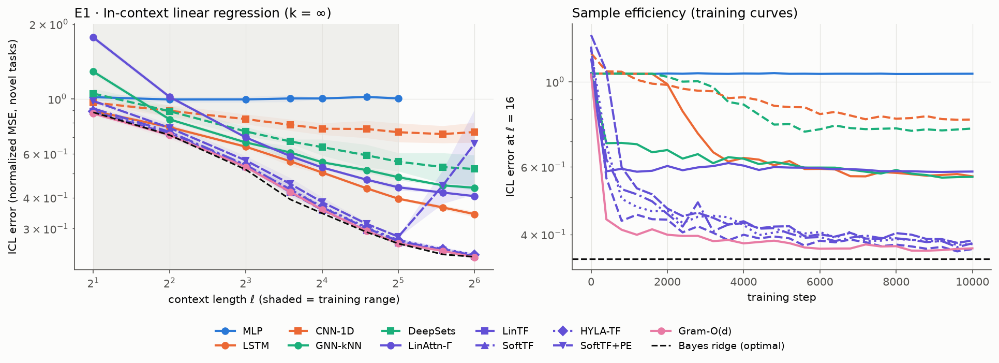
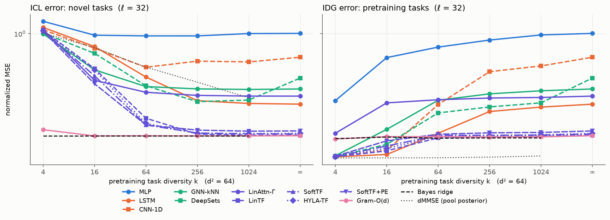
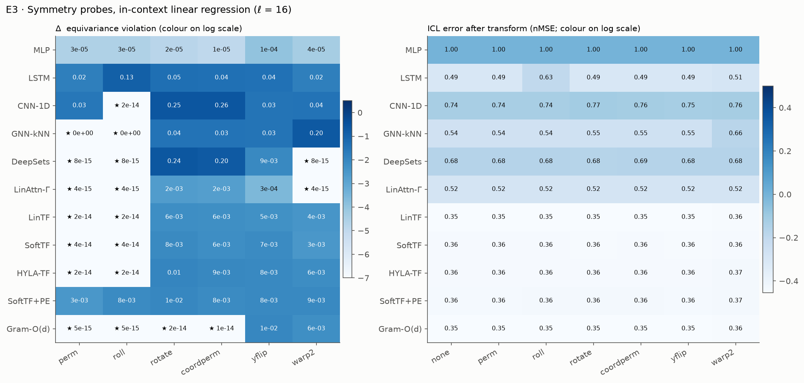
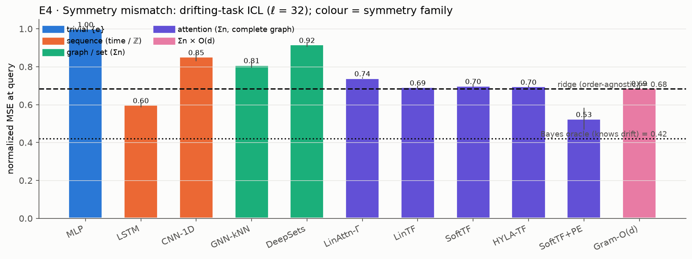
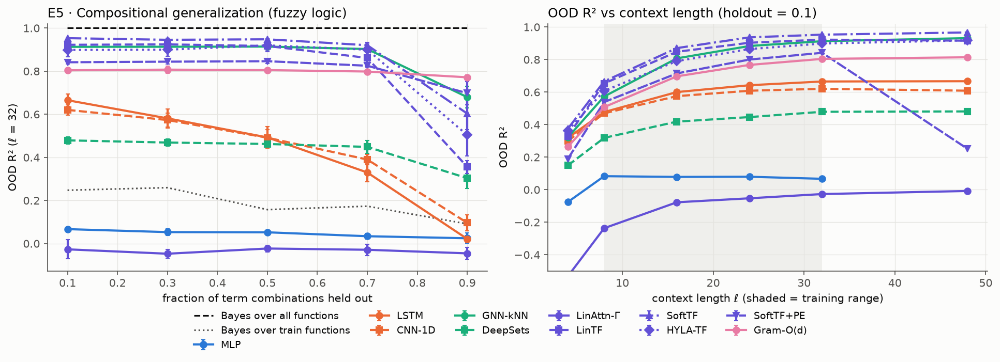
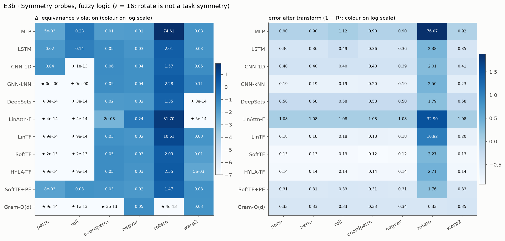

# ICL-Symmetry-Groups-Benchmark

**How does the symmetry group of a neural network shape its in-context learning?**

This repository is a controlled benchmark of **in-context learning (ICL)** across eleven architectures. Each architecture realizes a different row of the *geometric deep learning* blueprint: grids, sets, graphs, sequences, rotation-invariant networks and three kinds of attention. All models are trained with an identical protocol on the ICL tasks of two reference papers, plus a task that deliberately breaks their symmetries. Test-time **symmetry probes** then measure which invariances each model has by construction and which it learns from data.

Everything is a single self-contained Jupyter notebook (PyTorch only). It runs on CUDA, Apple-Silicon (MPS) or CPU and needs no internet once installed.

[](LICENSE)


---

## Highlights

Mean over 3 seeds, from the `MODE='FULL'` run saved in this repository. "Error" is normalized MSE, 1.0 = predicting the mean; 0.261 is the Bayes-optimal (ridge) level.

| Finding | Evidence |
|---|---|
| **Built-in symmetries hold exactly** | Every invariance that holds by construction has equivariance violation Δ < 10⁻¹². |
| **Rotation invariance removes the memorization regime** | Pretrained on only **k = 4 tasks**, `Gram-O(d)` reaches ICL error **0.283** (ridge: 0.261). Every other model memorizes the 4 tasks and scores ≥ 0.998 on new ones. |
| **…and buys task/sample efficiency, not asymptotic accuracy** | With unlimited task diversity the Σn Transformers catch up (0.263–0.269). `Gram-O(d)` crosses error 0.5 after 400 steps vs 800–1600 for the Transformers. |
| **Permutation invariance alone is not enough** | `DeepSets`, `GNN-kNN` and `LinAttn-Γ` are exactly permutation-invariant but plateau at 0.44–0.56. The order-sensitive `LSTM` reaches 0.396. |
| **Positional encodings: order vs. extrapolation** | `SoftTF+PE` is best on an order-dependent task (0.525; oracle 0.422, order-agnostic ridge 0.684) but fails on longer contexts (0.661 at ℓ = 64 vs 0.234 without PE). |
| **Compositional ICL** | Softmax attention reaches OOD R² 0.95 on held-out fuzzy-logic compositions. With 90 % held out, `Gram-O(d)` is best (0.77) and sequence models collapse (≤ 0.10). |

**Why rotation invariance prevents memorization.** For isotropic inputs, an O(d)-invariant predictor has the same risk on every rotation `Rw` of a task `w`. Training on a pool of tasks is therefore equivalent to training on a prior that keeps only the task *norms*. The best such predictor is a posterior mean close to ridge regression, so dMMSE-style memorization is impossible. The full argument is in the notebook.

---

## Architectures and their symmetry groups

| Model | GDL row | Domain Ω | Built-in symmetry 𝔊 | Params |
|---|---|---|---|---:|
| `MLP` | — (baseline) | fixed-size vector | trivial | 159k |
| `LSTM` | LSTM | 1D grid | time warping | 266k |
| `CNN-1D` | CNN | cyclic 1D grid | translation ℤ_T | 134k |
| `GNN-kNN` | GNN | kNN graph in x-space | permutation Σn (local) | 77k |
| `DeepSets` | Deep Sets | set | Σn | 68k |
| `LinAttn-Γ` | Transformer (Lu et al. reduced model) | set | Σn | 72 |
| `LinTF` | Transformer, linear attention | complete graph | Σn | 101k |
| `SoftTF` | Transformer, softmax attention | complete graph | Σn | 101k |
| `HYLA-TF` | Transformer, HYLA attention (Schug et al.) | complete graph | Σn | 101k |
| `SoftTF+PE` | Transformer + positional encoding | sequence | none (Σn broken) | 101k |
| `Gram-O(d)` | rotation-equivariant analog of spherical CNNs | complete graph, invariant edge features ⟨xᵢ, xⱼ⟩ | Σn × O(d) | 165k |

## Tasks and experiments

| | Task | What it tests |
|---|---|---|
| **E1** | In-context linear regression (Lu et al.), d = 8, noise ρ = 0.25 | ICL error vs context length, including extrapolation to 2× the training length; training curves |
| **E2** | Same, with a finite pool of k pretraining tasks | The memorization → ICL transition (ICL vs IDG error, against Bayes ridge and dMMSE) |
| **E3** | Test-time group actions: permutation, cyclic shift, O(d) rotation, coordinate permutation, y-sign flip, time-warp (token duplication), variable negation | Equivariance violation Δ = E[(f(gZ) − ρ(g) f(Z))²] / Var(y) |
| **E4** | Drifting regression (the task vector changes along the context) | Symmetry *mismatch*: order matters, so permutation invariance should hurt |
| **E5** | Fuzzy-logic DNF functions (Schug et al.) with held-out term combinations | Compositional generalization (OOD R²) vs held-out fraction and context length |

## Results

| | |
|---|---|
|  |  |
| **E1** ICL error vs context length and training curves | **E2** ICL and IDG error vs task diversity k |
|  |  |
| **E3** Symmetry probes (★ = invariant by construction) | **E4** Order-dependent (drifting) task |
|  |  |
| **E5** Compositional ICL on fuzzy logic | **E3b** Symmetry probes on fuzzy logic |

All numbers are in [`results/summary.csv`](results/summary.csv) and [`results/all_results.json`](results/all_results.json).

---

## Quick start

### 1. Install (once)

Python ≥ 3.9.

**macOS (Apple Silicon)**
```bash
python -m venv .venv && source .venv/bin/activate
pip install torch numpy matplotlib pandas jupyter
```

**Windows / Linux with an NVIDIA GPU.** The default PyPI `torch` on Windows is CPU-only. Install the CUDA build using the selector at [pytorch.org](https://pytorch.org/get-started/locally/), for example:
```bash
pip install torch --index-url https://download.pytorch.org/whl/cu126
pip install numpy matplotlib pandas jupyter
python -c "import torch; print(torch.cuda.is_available())"   # should print True
```

### 2. Run

```bash
jupyter notebook ICL_symmetry_groups_benchmark_local.ipynb
```
Set `MODE` in the first code cell, then run all cells.

| `MODE` | Seeds | Steps | Approx. runtime | Use |
|---|---|---|---|---|
| `SMOKE` | 1 | 40 | 1–3 min | check that everything runs |
| `QUICK` | 1 | 5 000 | ~1 h (GPU), 2–4 h (Mac) | first look |
| `FULL` | 3 | 10 000 | 6–10 h (GPU); ≈ 40 h on a Mac CPU | the results in this repo |

**Device selection is automatic:** CUDA → MPS → CPU. On a Mac the notebook times a few steps on MPS and on CPU and picks the faster one. To force a device, set `DEVICE_PREF = 'cuda' | 'mps' | 'cpu'`. On MPS the `LSTM` trains on the CPU (MPS LSTM kernels leak memory), and any model that runs out of memory is retried on the CPU automatically.

Figures, `summary.csv` and `all_results.json` are written to `results/`.

### Configuration

All hyperparameters are at the top of the notebook. They include:
* the task dimension `d` and noise `ρ`;
* the context-length ranges;
* the model width;
* the task-diversity list `k_list` and the held-out fractions;
* `MODEL_NAMES`; remove models here to save time.

## Repository layout

```
ICL-Symmetry-Groups-Benchmark/
├── ICL_symmetry_groups_benchmark_local.ipynb   # the whole benchmark (tasks, models, training, probes, plots)
├── results/
│   ├── E1_icl_vs_length.png       # E1: context length + training curves
│   ├── E2_task_diversity.png      # E2: memorization → ICL transition
│   ├── E3_probes_linreg.png       # E3: symmetry probes (linear regression)
│   ├── E3b_probes_fuzzy.png       # E3b: symmetry probes (fuzzy logic)
│   ├── E4_drift_mismatch.png      # E4: order-dependent task
│   ├── E5_fuzzy_compositional.png # E5: compositional generalization
│   ├── summary.csv                # one row per model
│   └── all_results.json           # every number (per model, seed, k, length, split)
├── LICENSE
└── README.md
```

## Implementation notes

* **Tokens** are `[x, y, query-flag]`. Every model finds the query by its flag, so cyclic shifts that move the query are well defined.
* **Training** for every model: AdamW (lr 1e-3; 1e-2 for the 72-parameter `LinAttn-Γ`), weight decay 1e-4, 5 % warm-up + cosine decay, gradient clipping 1, batch 128, fresh samples every step, 4096 fixed evaluation contexts.
* **`Gram-O(d)`** builds node states only from invariants `(y, flag, ‖x‖²)` and passes messages `Σⱼ Σₚ ⟨xᵢ, xⱼ⟩ᵖ Wₚ hⱼ / T` (p = 0…3). This is a continuous-filter convolution on the complete graph, exactly Σn × O(d)-invariant. The p = 1 term makes kernel gradient descent expressible.
* **Departures from the reference papers.**
  * HYLA and linear attention are normalized by context length (1/T) so the models can be evaluated beyond the training length.
  * The Transformers are bidirectional encoders with sinusoidal (not relative) positions in the `+PE` variant.
  * The Spherical-CNN row is represented by its group content, O(d) acting on the input space. Mesh/gauge CNNs have no natural counterpart for token sets.

## Citation

If you use this benchmark, please cite the repository:

```bibtex
@misc{satarydizaji2026iclsymmetry,
  author       = {Satary Dizaji, Aslan},
  title        = {{ICL-Symmetry-Groups-Benchmark}: In-context learning across geometric deep learning architectures with different symmetry groups},
  year         = {2026},
  howpublished = {\url{https://github.com/aslansd/ICL-Symmetry-Groups-Benchmark}}
}
```

## References

* Y. M. Lu, M. I. Letey, J. A. Zavatone-Veth, A. Maiti, C. Pehlevan. *Asymptotic theory of in-context learning by linear attention.* PNAS 122(28), e2502599122, 2025.
* S. Schug, S. Kobayashi, Y. Akram, J. Sacramento, R. Pascanu. *Attention as a hypernetwork.* ICLR 2025.
* M. M. Bronstein, J. Bruna, T. Cohen, P. Veličković. *Geometric deep learning: grids, groups, graphs, geodesics, and gauges.* arXiv:2104.13478, 2021.
* A. Raventós, M. Paul, F. Chen, S. Ganguli. *Pretraining task diversity and the emergence of non-Bayesian in-context learning for regression.* NeurIPS 2023.

## License

[MIT](LICENSE) © 2026 Aslan Satary Dizaji
